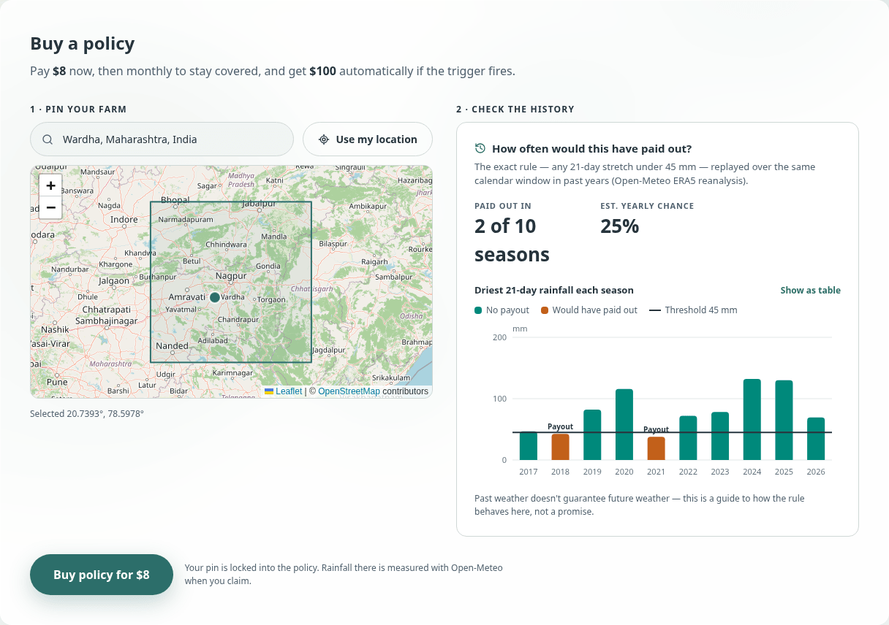

# Insure — parametric insurance on Solana

[](https://github.com/codebird-n4vnt/insure/actions/workflows/ci.yml)

**Insurance that pays when the data says so.** Farmers buy drought cover, travellers buy flight-delay cover, and anyone can underwrite it with USDC. When a claim is filed, an oracle fetches the real-world data, applies the vault's published rule, and pays out in minutes. The measured value and a hash of the evidence go on-chain for anyone to verify.



- **For users:** read the **[User guide](docs/USER_GUIDE.md)**. It covers buying, renewing, claiming, verifying payouts and running a vault, step by step with screenshots.
- **For developers and reviewers:** everything else is below.

## Contents

1. [What you can do](#what-you-can-do)
2. [How it works](#how-it-works)
3. [Trust model](#trust-model)
4. [Security review](#security-review)
5. [See it running in 5 minutes](#see-it-running-in-5-minutes)
6. [Deploy to devnet](#deploy-to-devnet)
7. [Configuration](#configuration)
8. [Getting API keys](#getting-api-keys)
9. [Tests](#tests)
10. [API reference](#api-reference)
11. [Program reference](#program-reference)
12. [Limitations and roadmap](#limitations-and-roadmap)

```
insure/      Anchor program (Rust) + LiteSVM tests
backend/     Oracle keeper (settles claims) + REST API + Solana Actions (Blinks)
frontend/    Next.js dApp
e2e/         One-command local stack + browser tests of every user flow
docs/        User guide and screenshots
scripts/     Repo helpers (IDL sync)
```

---

## What you can do

| Who | What | Guide |
|---|---|---|
| **Farmers** | Pin a farm on a map, see how often a vault's rule would have paid there over the last 10 years, buy monthly drought cover, file a claim in one click, get paid automatically | [Drought cover](docs/USER_GUIDE.md#2-farmers-drought-cover) |
| **Travellers** | Insure one flight against cancellation, diversion or delay; claim after departure | [Flight cover](docs/USER_GUIDE.md#3-travellers-flight-delay-cover) |
| **Anyone** | Open any claim and have the browser re-hash its evidence against the on-chain hash; re-fetch the source data | [Checking a payout](docs/USER_GUIDE.md#4-checking-any-payout) |
| **Underwriters** | Draw a coverage region, get a suggested premium from 10 years of rainfall, fund a vault, earn a fee on every premium, free capital from lapsed policies, withdraw at the end | [Running a vault](docs/USER_GUIDE.md#5-underwriters-running-a-vault) |

Other features:
- **Blinks.** Any vault can be bought through a Solana Action link.
- **Onboarding.** There's a devnet-only demo wallet for people without one, live balances, and one-click faucets.
- **Live updates.** Pages update over websockets; there's no manual refresh.
- **Chain clock.** Eligibility messages use the cluster clock, so they always match what the program enforces.

---

## How it works

```
policyholder              program (on-chain)                    oracle keeper (backend)
────────────              ──────────────────                    ───────────────────────
subscribe(risk) ────────▶ policy stores farm lat/lon or flight
  + 1st premium           (fixed forever), checks region and
                          that the vault can pay

raise_claim() ──────────▶ Claim{Pending}, emits ClaimFiled ───▶ event, or a sweep every 60 s
                                                                fetch data: Open-Meteo / flight API
                                                                apply the vault's rule in code
                                                                (Gemini: messy-JSON extraction +
                                                                 plain-English explanation only)
                                                                write evidence JSON, SHA-256 it
                          settle_claim(approved, observed,  ◀── signed by the oracle key
                                       evidence_hash)
USDC payout  ◀─────────── treasury → claimant's USDC account
```

**The rules**
- **Drought:** pays if the total rainfall at the policy's pin over the *N* full days before filing is below the threshold. The window always ends inside paid coverage.
- **Flight:** pays if the flight was cancelled or diverted, or its departure *or* arrival was late by at least the threshold.

All the time windows are in the [rules table](docs/USER_GUIDE.md#6-rules-at-a-glance).

**Where Gemini fits.** Payout decisions are deterministic code, because parametric insurance only works if the same data always gives the same verdict. An LLM "judge" can't promise that and can't be audited; fine-tuning wouldn't change it. Gemini does the two jobs it's good at, and both are optional:
1. **Extraction fallback.** When a flight API returns JSON the parser can't match, Gemini extracts `{status, delays}` using a strict schema at temperature 0. The provider data is fenced as untrusted input. The result is used only if the flight number and date match exactly, and it still goes through the same coded rule.
2. **Explanations.** It writes a 2–3 sentence note for the policyholder, capped at 20 s so it can never delay a payout.

With no `GEMINI_API_KEY`, everything works the same, minus the prose.

---

## Trust model

`settle_claim` can only be signed by `Config.oracle_authority`, a key registered by the program's upgrade authority. Users trust that key to apply the published rule honestly. In return, the design makes every decision checkable and limits what the oracle, underwriters and users can do:

- **Rules are fixed and public.** Each vault's rule is on-chain before anyone buys; the insured risk is locked at purchase.
- **Every decision is auditable.** The measured value and the SHA-256 of the full evidence bundle (raw data, source URL, rule and verdict) are stored on the claim. The claim page re-hashes the bundle in the browser.
- **Full collateral.** Every policy locks one full payout, and the program refuses to sell cover it can't pay.
- **No escape from payouts.** Underwriters can't withdraw committed capital, close a vault while claims are pending, or pause their way out of a payout.
- **Nothing gets stuck.** If data never arrives, the claim is rejected after 72 h and can be re-filed. If the oracle is down for more than 7 days after expiry, the underwriter can still close the vault.

Moving to M-of-N oracle signers, or running the keeper in a TEE, changes `SettleClaim` only.

---

## Security review

The hackathon version was audited and rebuilt. Every on-chain fix has a regression test in `insure/programs/insure/tests/`.

| # | Severity | Issue | Fix |
|---|---|---|---|
| 1 | **Critical** | `settle_claim` accepted *any* caller-supplied Switchboard feed and paid if its value was `1`, so anyone could drain every vault | Settlement requires the registered oracle's signature |
| 2 | **Critical** | Unlimited claims per policy, each paying the full amount | One pending claim at a time; one payout per policy; exposure released on payout |
| 3 | **Critical** | The claimant chose the location or flight *at claim time*, so they could point at any drought or delayed flight | Insured risk fixed at purchase, validated against the vault type |
| 4 | High | Free `subscribe` reserved capacity, letting anyone lock a vault (DoS) | Subscribing pays the first premium atomically |
| 5 | High | Unbounded `creator_fee_bps` (>10000 made every renewal panic) | Capped at 50% |
| 6 | High | Fees paid straight to the creator's token account; closing it blocked all renewals | Fees accrue in the treasury; collected on demand |
| 7 | High | `creator_withdraw` could empty the treasury with claims pending | Blocked while claims are pending (7-day escape hatch after expiry) |
| 8 | High | Pausing blocked settlement, so a creator could pause to avoid payouts | Pause only stops new sales |
| 9 | High | Farms accepted *anywhere*: the same rule pays 1 year in 10 near Nagpur but 10 in 10 in Jaisalmer (adverse selection) | Coverage region (≤ 10° box) enforced in `subscribe` |
| 10 | Medium | Underwriter could set expiry 1 s after coverage ends, making late claims impossible | Expiry ≥ coverage end + 7-day filing grace |
| 11 | Medium | Mint not stored or checked; decimals hard-coded | Mint pinned in `Config` and checked everywhere; decimals read from the mint |
| 12 | Medium | Payout failed if the claimant closed their USDC account | Oracle recreates it (`init_if_needed`) |
| 13 | Medium | Flight cover could be bought after the flight was delayed | Flight date inside coverage; purchase before the flight day; claims only from it |
| 14 | Medium | 30-day window + 30-day premium made weather claims fileable for ~0 seconds | 7-day filing grace; window ends at paid cover end |
| 15 | Medium | Lapsed policies locked underwriter capital until expiry | Permissionless `release_lapsed_policy` once every renewal and claim window has closed |
| 16 | Medium | Helius API key committed in `Anchor.toml` | Removed. **The key is still in git history (commit `995af3e`); rotate it.** |
| 17 | Low | `Config` could be front-run at deployment | Only the program's upgrade authority can create it; zero-key updates rejected |
| 18 | Low | Float `f64` coordinates (NaN/∞ accepted) | `i32` micro-degrees with range checks |
| 19 | Low | Stack overflow in `raise_claim` account deserialisation | Large accounts boxed |
| 20 | Low | Claim status at a variable offset forced full scans of every claim | `status` at a fixed offset (112); keeper fetches pending claims only |

Why the old oracle never produced a correct answer:
- It judged "drought" from a *current weather* snapshot (no rainfall history).
- It tried to pay non-x402 APIs through x402.
- It created an `OracleQuote` account that the program parsed as a `PullFeedAccountData`.
- It never loaded `.env`.

---

## See it running in 5 minutes

The fastest way to see everything is the local stack. It runs a local validator ([surfpool](https://surfpool.run), with time travel), the real program, a local USDC mint, the oracle keeper and the app, with no devnet, faucets or API keys needed.

Prerequisites:
- Rust + [Solana CLI](https://solana.com/docs/intro/installation) + [Anchor](https://www.anchor-lang.com/docs/installation) 1.x
- Node 20+
- surfpool
- Chrome, for the browser tests

```bash
(cd insure && anchor build)
(cd backend && npm install) && (cd frontend && npm install) && (cd e2e && npm install)

cd e2e
bash stack.sh up                   # app http://localhost:3100 · API :3001 · RPC :8899
```

Open <http://localhost:3100>, choose **Demo Wallet** in the wallet menu, and copy its address (wallet button → **Copy address**). Then:

```bash
bash stack.sh fund <ADDRESS> 1000  # local SOL + 1000 USDC
bash stack.sh warp 30              # fast-forward the chain 30 days (e.g. to file a claim)
npm test                           # run all 8 browser scenarios (screenshots in e2e/.state/shots)
bash stack.sh down
```

---

## Deploy to devnet

**Live on devnet:** program [`DnmURZWk5UgpQnFoonbm58KoZjAuM4a4uvMysi3HzhR3`](https://explorer.solana.com/address/DnmURZWk5UgpQnFoonbm58KoZjAuM4a4uvMysi3HzhR3?cluster=devnet), with its config set to oracle `AfP3tEb3zCpUHisnty76KAz53L3Bu71xs2oJu3zRnsJ5` and Circle devnet USDC. The pre-audit hackathon version at `5v7W…` is still on devnet but no longer used. The steps below deploy your own copy.

A step-by-step runbook. Costs are in devnet SOL, which is free (`solana airdrop` or <https://faucet.solana.com>).

**1. Wallet and cluster**

```bash
solana config set --url devnet
solana-keygen new                     # skip if ~/.config/solana/id.json exists; this key becomes the upgrade authority
solana airdrop 2                      # repeat (or use the web faucet) until you have ~3 SOL
```

**2. Program.** The program is 508 KB. Its account took **2.58 SOL** of rent on devnet (Oct 2026). The upload buffer costs the same, but the loader refunds it before paying for the program account, so about 2.7 SOL covers a deploy.

- **Fresh deploy (new program ID).**
  ```bash
  cd insure
  anchor keys sync                    # writes your program ID into lib.rs (check Anchor.toml: it may only update [programs.devnet])
  anchor build
  anchor deploy --provider.cluster devnet
  cd .. && bash scripts/sync-idl.sh   # copy the IDL/types into backend/ and frontend/
  ```
- **Upgrade later.** Rebuild, then run `anchor deploy --provider.cluster devnet` as the upgrade authority. Extend the program account first if the new binary is larger: `solana program extend <PROGRAM_ID> <extra-bytes>`.
- **If the upload stalls** (the public RPC answers `429 Too many requests`), deploy with `solana program deploy` and its default mode, which sends writes straight to validators. Avoid `--use-rpc`, which sends every write through the rate-limited RPC. Pass `--buffer <keypair-file>` so a failed upload can resume.

**3. Oracle and protocol config**

```bash
cd backend
npm install
cp .env.example .env                  # then fill in RPC_URL and optional API keys (see Configuration)
solana-keygen new -o oracle-keypair.json --no-bip39-passphrase
solana transfer $(solana-keygen pubkey oracle-keypair.json) 0.5 --allow-unfunded-recipient
npm run init-config                   # signs with ~/.config/solana/id.json (the upgrade authority)
npm run evaluate -- weather 20.7 77.0 30 50   # optional: dry-run the oracle on live data
```

`init-config` registers the oracle key and pins **Circle devnet USDC** (`4zMMC9s…ncDU`). Pass `--mint <MINT>` to use another mint. Re-running it with a different `ORACLE_KEYPAIR` rotates the oracle.

**4. Run the keeper + API.** It must be a **long-running process** (a VM, Railway, Render, Fly…), not a serverless function. Mount `EVIDENCE_DIR` on persistent storage: the evidence files are what users verify.

```bash
npm start                             # then check: curl <host>/health
```

`/health` reports the keeper status, the oracle's SOL balance (`oracleBalanceLow` → top it up), deferred claims and which data providers are configured.

**5. Frontend** (e.g. on Vercel, with the project root set to `frontend/`):

```bash
cd frontend
cp .env.example .env.local            # NEXT_PUBLIC_* values, see Configuration
npm run build && npm start
```

Set the backend's `ALLOWED_ORIGINS` and `SITE_URL` to the frontend's public URL.

**6. Smoke test.** Create a vault with a short timeline, buy a policy from a second wallet, and check the vault in the marketplace. The repo's `vercel.json` targets Vercel's experimental multi-service deploys: use it for the frontend, but host the keeper as described in step 4.

---

## Configuration

**Backend (`backend/.env`)**

| Variable | Required | Default | Purpose |
|---|---|---|---|
| `RPC_URL` | yes | public devnet | Solana RPC. Use a private one; the public endpoint rate-limits account scans |
| `WS_URL` | no | derived | Websocket endpoint for claim events |
| `CLUSTER` | no | `devnet` | Label, Blink chain ID |
| `ORACLE_KEYPAIR` | for the keeper | — | Path, JSON array or base58 secret of the oracle key. Empty = read-only API |
| `KEEPER_ENABLED` | no | `true` | Turn settlement off without removing the key |
| `POLL_INTERVAL_SECONDS` | no | `60` | Safety-net sweep for pending claims |
| `DATA_DEADLINE_HOURS` | no | `72` | Reject (re-fileable) if no usable data by then |
| `EVIDENCE_DIR` | no | `./data/evidence` | Where evidence bundles are written; must persist |
| `AVIATIONSTACK_API_KEY` / `AERODATABOX_API_KEY` | for flight cover | — | Flight data (AeroDataBox is tried first if set) |
| `GEMINI_API_KEY` | no | — | Extraction fallback + explanations |
| `GEMINI_MODELS` | no | `gemini-2.5-flash,gemini-2.5-flash-lite` | Tried in order |
| `PORT` | no | `3001` | API port |
| `ALLOWED_ORIGINS` | recommended | any | Frontend origin(s), comma-separated |
| `SITE_URL` | recommended | `http://localhost:3000` | Public site URL for Blink icons and links |

**Frontend (`frontend/.env.local`)**

| Variable | Default | Purpose |
|---|---|---|
| `NEXT_PUBLIC_RPC_URL` | public devnet | Solana RPC for the browser |
| `NEXT_PUBLIC_WS_URL` | derived | Websocket for live updates |
| `NEXT_PUBLIC_CLUSTER` | `devnet` | Label, explorer links; `mainnet` hides the demo wallet and faucets |
| `NEXT_PUBLIC_USDC_MINT` | Circle devnet USDC | Must equal `Config.usdc_mint` |
| `NEXT_PUBLIC_BACKEND_URL` | `http://localhost:3001` | Keeper/API URL (cached reads, evidence, Blinks) |
| `NEXT_PUBLIC_SITE_URL` | `http://localhost:3000` | Social previews |
| `NEXT_PUBLIC_DEMO_WALLET` | on (non-mainnet) | Set `false` to hide the demo wallet |

---

## Getting API keys

Weather needs **no key** (Open-Meteo). The rest are optional or needed only for flight cover. Free tiers change, so check each provider's current plan.

| Service | Used for | How |
|---|---|---|
| **Private RPC** (e.g. Helius, Triton, QuickNode) | Reliable reads and account scans | Create a free account and copy the **devnet** RPC URL into `RPC_URL` / `NEXT_PUBLIC_RPC_URL`. Keep it in `.env`, never in committed files |
| **AeroDataBox** (via RapidAPI) | Flight status by number + date, including recent history | Subscribe to AeroDataBox on RapidAPI (it has a free tier), copy your `X-RapidAPI-Key` into `AERODATABOX_API_KEY` |
| **Aviationstack** | Flight status (fallback) | Sign up and copy the access key into `AVIATIONSTACK_API_KEY`. The free plan is HTTP-only, rate-limited and real-time only, so claims must be checked around the flight date |
| **Gemini** | Optional extraction fallback + explanations | Create a key in Google AI Studio and set `GEMINI_API_KEY` |

---

## Tests

| Suite | Command | What it covers |
|---|---|---|
| Program (31 tests) | `cd insure && cargo test` | Every instruction's rules and each exploit above as a regression, run against the compiled program in LiteSVM |
| Backend (24 tests) | `cd backend && npm test` | Oracle rules and parsers; Gemini failure modes (rate limits, retired models, invalid or blocked answers, hung calls); evidence hashing; full claim lifecycles against the compiled program |
| Frontend | `cd frontend && npx eslint src && npx tsc --noEmit && npm run build` | Lint, types, production build |
| Browser (8 scenarios) | `cd e2e && bash stack.sh up && npm test` | Wallets; vault creation; buying via UI and Blink; claim → real-data payout → in-browser evidence verification; keeper recovery after downtime; fees; releasing lapsed policies; flight deferral |

CI runs the first three on every push (`.github/workflows/ci.yml`).

---

## API reference

The backend serves the oracle's evidence and cached read endpoints. All `GET`; rate-limited to 120 requests/min per IP.

| Endpoint | Returns |
|---|---|
| `GET /health` | Keeper status, oracle balance, deferred claims, configured providers |
| `GET /stats` | Protocol totals (liquidity, policies, claims, payouts) |
| `GET /evidence/:claim` | The exact evidence bytes whose SHA-256 is on the claim |
| `GET /raw/vaults[?authority=]` | Vault accounts (base64, decode with the IDL) |
| `GET /raw/policies?owner=` · `?vault=` | Policy accounts |
| `GET /raw/claims?claimant=` · `?vault=` · `/raw/claims/recent?limit=` | Claim accounts |
| `GET /vaults`, `/vaults/:address[/policies\|/claims]`, `/policy/:vault/:wallet`, `/policies/:wallet`, `/claims/:wallet`, `/config` | The same data as JSON |
| `GET` / `POST /api/actions/vaults/:vault` | Solana Action (Blink) to buy cover; `POST {account}` with `?lat=&lon=` or `?flight=&date=` returns a transaction to sign |
| `GET /actions.json` | Blink discovery (the frontend also serves one mapping `/vaults/*`) |

---

## Program reference

| Instruction | Signer | Rules |
|---|---|---|
| `initialize_config(oracle)` | upgrade authority | Once; pins the USDC mint |
| `update_config(admin, oracle)` | admin | Rotate keys; zero keys rejected |
| `initialize_vault(...)` | anyone | Windows ordered; expiry ≥ coverage end + 7 d; fee ≤ 50%; payout > premium; drought: 1–90-day window, region ≤ 10°; flight: threshold ≤ 3 days |
| `deposit_liquidity(amount)` | vault creator | Until coverage ends |
| `withdraw_excess_liquidity(amount)` | vault creator | Only capital not backing policies |
| `claim_creator_fees()` | vault creator | Any time |
| `set_vault_paused(bool)` | vault creator | Stops new sales only |
| `subscribe(risk)` | buyer | Sales window; risk matches vault type; farm in region; free capacity; pays first premium |
| `pay_premium()` | policyholder | Drought only; +30 days; up to 10 days after cover ends |
| `raise_claim()` | policyholder | 0.005 USDC fee; one pending at a time; timing per [rules](docs/USER_GUIDE.md#6-rules-at-a-glance) |
| `settle_claim(approved, observed, hash)` | oracle | Pays the vault's payout on approval; records value and evidence hash |
| `release_lapsed_policy()` | anyone | Drought policy past every renewal and claim window, no pending claim |
| `creator_withdraw()` | vault creator | After expiry; no pending claims (or 7 days after expiry) |

`observed_value`: rainfall in 0.1 mm for drought; delay in minutes for flights (`-1` cancelled, `-2` diverted).

---

## Limitations and roadmap

**Current limitations:**
- **One oracle key.** Decisions are auditable, but a single key signs them. *Next:* M-of-N oracle signers, or the same keeper code in a TEE.
- **Evidence storage.** Bundles live on the keeper's disk. *Next:* pin them to Arweave/IPFS so the evidence outlives the server.
- **Basis risk.** Rainfall comes from gridded reanalysis and analysis data (kilometre-scale), not a gauge in the field. It can differ from what fell on a specific farm. The backtest shows how the rule behaved at each pin historically.
- **Flight data.** Free tiers are limited; production needs a paid provider with historical lookups.
- **Status.** Devnet only. This is not a regulated insurance product, and it needs an external audit before any mainnet use.
- **Blinks on X.** Showing Blinks on X requires registering the site with Dialect.
